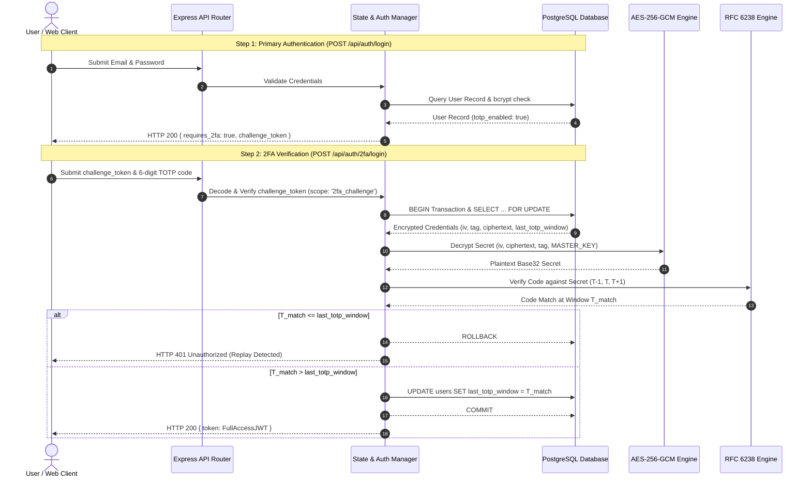

# Secure 2FA Login System with TOTP and Encrypted Credential Storage

A robust, enterprise-grade authentication system featuring two-factor authentication via Time-Based One-Time Passwords (RFC 6238), symmetric encryption at rest using AES-256-GCM, multi-stage authentication state flows, constant-time validation, and stateful replay protection.

## Core Capabilities & Security Features

1. **RFC 6238 TOTP Engine**
   - High-precision HMAC-SHA1 dynamic truncation.
   - Standard 30-second time steps with configurable window drift compensation ($\pm 1$ window).
   - Generates and exports standard `otpauth://totp/` URIs and Base32 secrets compatible with Google Authenticator, Authy, etc.
   - Side-channel mitigation via `crypto.timingSafeEqual` constant-time comparisons.

2. **AES-256-GCM Encryption at Rest**
   - Base32 shared secrets are **never** stored in plaintext.
   - Encrypted at the application layer before writing to PostgreSQL.
   - Unique, cryptographically random 12-byte Initialization Vector (IV) generated per encryption operation.
   - 16-byte Authentication Tag (AEAD) verified prior to payload decryption to prevent ciphertext tampering.

3. **Multi-Stage Authentication State Machine**
   - Non-2FA users receive full session JWTs upon valid password verification.
   - 2FA-enabled accounts branch into an intermediary `ChallengePending` state, issuing a short-lived, restricted `challenge_token` (`scope: '2fa_challenge'`).
   - Strict privilege separation: `challenge_token` cannot access protected application endpoints.

4. **Stateful Replay Attack Defense**
   - Tracks the exact matched time window ($T_{match}$) of each successful TOTP authentication.
   - Atomically compares $T_{match}$ against `last_totp_window` inside a PostgreSQL row-locked transaction (`SELECT ... FOR UPDATE`).
   - If $T_{match} \le \text{last\_totp\_window}$, request is rejected with `401 Unauthorized`.

---

## Architecture Diagram



---

## Environment Variables (`.env.example`)

| Variable | Description | Example / Format |
|---|---|---|
| `DATABASE_URL` | PostgreSQL connection string | `postgresql://postgres:postgres@db:5432/secure_auth` |
| `JWT_SECRET` | Secret key for JWT signing | `super_secret_jwt_key_min_32_chars` |
| `MASTER_ENCRYPTION_KEY` | 32-byte (256-bit) hex string for AES-256-GCM | `0123456789abcdef0123456789abcdef0123456789abcdef0123456789abcdef` |
| `PORT` | HTTP server port | `3000` |
| `NODE_ENV` | Environment identifier | `production` / `development` |

---

## Database Schema (`users` table)

| Column | Type | Constraints | Description |
|---|---|---|---|
| `id` | SERIAL / Integer | PRIMARY KEY | Unique user identifier |
| `email` | VARCHAR(255) | UNIQUE, NOT NULL | User login email address |
| `password_hash` | VARCHAR(255) | NOT NULL | Salted bcrypt password hash |
| `totp_enabled` | BOOLEAN | NOT NULL, DEFAULT false | Whether 2FA is active |
| `totp_secret_encrypted` | TEXT | NULLABLE | AES-256-GCM ciphertext of Base32 secret |
| `totp_iv` | TEXT | NULLABLE | 12-byte initialization vector (hex) |
| `totp_tag` | TEXT | NULLABLE | 16-byte authentication tag (hex) |
| `last_totp_window` | INTEGER | NULLABLE | Epoch 30s window counter of last used code |

---

## Pre-seeded Evaluation Test User (`submission.json`)

```json
{
  "testUser": {
    "email": "test_2fa@example.com",
    "password": "securePassword123",
    "plaintextTotpSecret": "JBSWY3DPEHPK3PXP"
  }
}
```

---

## API Endpoints Reference

### 1. Register User
- **`POST /api/auth/register`**
  - **Body**: `{ "email": "user@example.com", "password": "password123" }`
  - **Status**: `201 Created`
  - **Response**: `{ "id": 1, "email": "user@example.com" }`

### 2. Primary Login
- **`POST /api/auth/login`**
  - **Body**: `{ "email": "user@example.com", "password": "password123" }`
  - **Response (2FA Disabled, 200 OK)**:
    ```json
    { "token": "<Full Access JWT>" }
    ```
  - **Response (2FA Enabled, 200 OK)**:
    ```json
    {
      "requires_2fa": true,
      "challenge_token": "<Restricted 5-min JWT>"
    }
    ```

### 3. Provision 2FA Secret
- **`POST /api/auth/2fa/setup`**
  - **Headers**: `Authorization: Bearer <Full Access JWT>`
  - **Status**: `200 OK`
  - **Response**:
    ```json
    {
      "secret": "JBSWY3DPEHPK3PXP",
      "uri": "otpauth://totp/Secure2FA:user@example.com?secret=JBSWY3DPEHPK3PXP&issuer=Secure2FA&algorithm=SHA1&digits=6&period=30"
    }
    ```

### 4. Activate 2FA
- **`POST /api/auth/2fa/verify`**
  - **Headers**: `Authorization: Bearer <Full Access JWT>`
  - **Body**: `{ "code": "123456" }`
  - **Status**: `200 OK`
  - **Response**: `{ "message": "2FA successfully enabled" }`

### 5. Secondary Login (2FA Challenge Completion)
- **`POST /api/auth/2fa/login`**
  - **Body**: `{ "challenge_token": "<token>", "code": "123456" }`
  - **Status**: `200 OK`
  - **Response**: `{ "token": "<Full Access JWT>" }`
  - **Replay Response (401 Unauthorized)**:
    ```json
    { "error": "TOTP code has already been used or expired (replay detected)" }
    ```

### 6. Protected Endpoint
- **`GET /api/protected`**
  - **Headers**: `Authorization: Bearer <Full Access JWT>`
  - Returns `200 OK` for access tokens; rejects challenge tokens with `403 Forbidden`.

---

## Running with Docker Compose

To build and start the PostgreSQL database and API service:

```bash
docker compose up -d --build
```

Monitor service health:
```bash
docker compose ps
```

Run test suite inside the container or locally:
```bash
npm test
```
